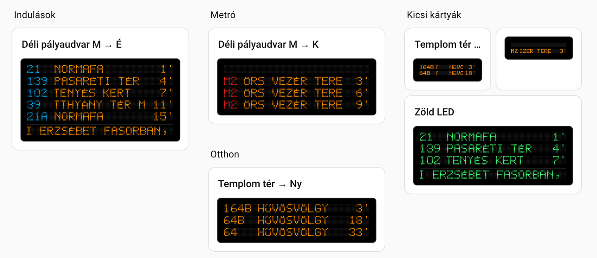
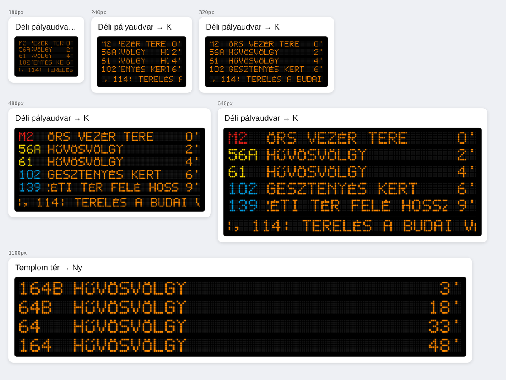
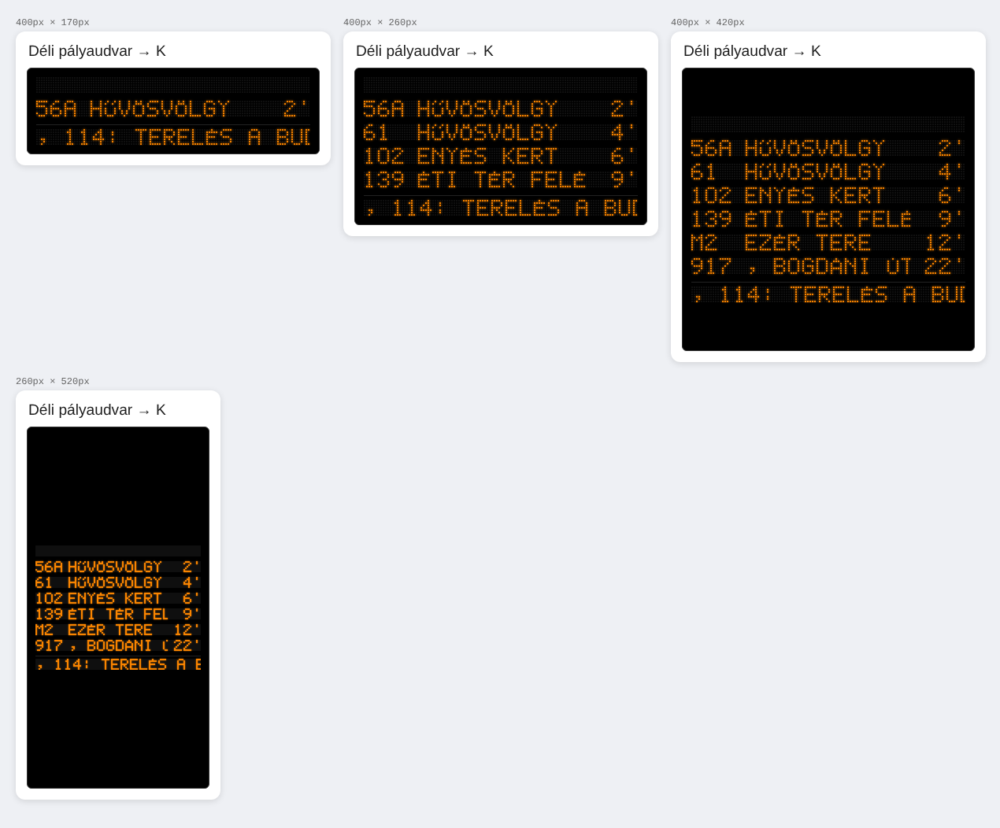
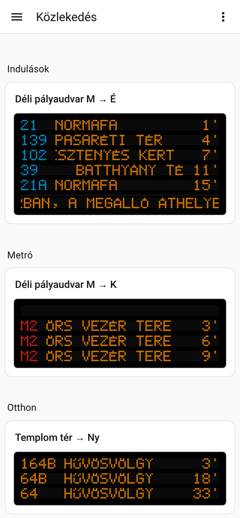

# 🟧 Dotmatrix Indulási Kijelző – Home Assistant kártya

[](https://hacs.xyz)
[](https://github.com/szbence7/dot-matrix-departure-card/releases)

Olyan kártya, mint egy igazi FUTÁR utastájékoztató kijelző a megállóban.



- 🔤 Saját rajzolású 5×7-es pöttyös betűkészlet, **teljes magyar ékezetkészlettel** (Ő, Ű is)
- ↔️ A hosszú végállomásnevek **görögnek**, mint a valódi kijelzőn
- 💡 A **most induló** járat sora villog
- ⚠️ Alul görgő **forgalmi zavar** sáv
- 🎨 Választható LED szín, és opcionálisan a járatszám a **járat saját színében** (M2 piros, villamos sárga…)
- 📐 **Bármilyen méretben szép**: telefonon, tableten, keskeny és széles kártyán is (lásd lent)

Az adatokat a **[Budapesti Indulások](https://github.com/szbence7/ha-budapest-departures)** integráció adja (BKK FUTÁR).

---

## Telepítés

1. Először telepítsd és állítsd be a **[Budapesti Indulások](https://github.com/szbence7/ha-budapest-departures)** integrációt (ott le van írva az ingyenes API kulcs igénylése is)
2. **HACS** → jobb felső **⋮** → **Egyéni tárolók** (Custom repositories)
3. Tároló: `https://github.com/szbence7/dot-matrix-departure-card`, típus: **Dashboard** → **Hozzáadás**
4. Keresd meg a **Dotmatrix Indulási Kijelző**-t → **Letöltés**
5. **Frissítsd a böngészőt** (telefonon az appban: húzd le az oldalt)

## Kártya hozzáadása

1. Dashboard → jobb felül **ceruza** (szerkesztés) → **+ Kártya hozzáadása**
2. Keresd: **Dotmatrix Indulási Kijelző**
3. Válaszd ki a megálló szenzorát – minden más opcionális, és a **vizuális szerkesztőben** állítható

---

## Méretek

A kártya magától igazodik a rendelkezésre álló helyhez: a pöttyök mérete a szélességhez igazodik, a járatszám- és perc-oszlop pont olyan széles, amilyen kell, a maradék hely a végállomásé.



Ha a *Sections* nézetben **fix magasságot** állítasz a kártyának, annyi sort mutat, amennyi kényelmesen elfér:



Telefonon:



---

## Beállítások

| Név | Alapérték | Leírás |
|---|---|---|
| `entity` | **kötelező** | A Budapesti Indulások integráció szenzora |
| `title` | megálló neve + irány | A kártya címe |
| `show_title` | `true` | Cím mutatása |
| `rows` | `6` | Indulási sorok száma |
| `color` | `#ff8800` | LED szín (borostyán, sárga, zöld, fehér, piros, vagy bármilyen CSS szín) |
| `route_colors` | `false` | Járatszám a járat hivatalos színében |
| `show_alerts` | `true` | Forgalmi zavar sáv alul |
| `background` | `true` | Fekete kijelző háttér (kikapcsolva átlátszó) |
| `scroll_speed` | `23` | Görgetés sebessége (pötty / másodperc) |
| `columns` | automatikus | Fix pötty/sor szám. Csak akkor add meg, ha mindenhol pontosan ugyanakkora betűket szeretnél |
| `empty_text` | `NINCS JÁRAT` | Ez látszik, ha nincs indulás |

### Példák

```yaml
# Egyszerű
type: custom:dot-matrix-departure-card
entity: sensor.templom_ter_ny_kovetkezo_indulas
```

```yaml
# Metró, járatszínekkel, 4 sor
type: custom:dot-matrix-departure-card
entity: sensor.deli_palyaudvar_m_k_kovetkezo_indulas
rows: 4
route_colors: true
```

```yaml
# Zöld LED, saját címmel
type: custom:dot-matrix-departure-card
entity: sensor.templom_ter_ny_kovetkezo_indulas
title: Buszom haza
color: "#3dff6e"
```

---

## Saját adatforrással

Bármilyen szenzorral működik, aminek van ilyen `departures` attribútuma:

```yaml
departures:
  - route: "57"
    headsign: Máriaremete
    departure: 1793605472   # unix idő, másodpercben
    color: "#009EE3"        # nem kötelező, a route_colors használja
```

## Fontos

Nem hivatalos projekt, a BKK Zrt.-hez nincs köze.

## Támogatás

Tetszik? Hívj meg egy kávéra! ☕

[](https://www.buymeacoffee.com/benceix)
