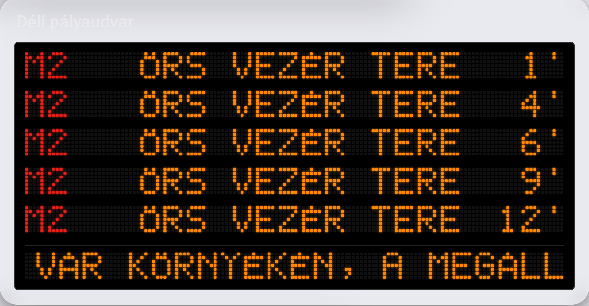

# Dotmatrix Indulási Kijelző – Home Assistant kártya

[](https://hacs.xyz)

Olyan kártya, mint egy igazi FUTÁR utastájékoztató kijelző: saját rajzolású 5×7-es pöttyös betűkészlet teljes magyar ékezetkészlettel, görgő hosszú végállomásnevek, villogó „most indul” sor és görgő forgalmi zavar sáv.



Az adatokat a **[Budapesti Indulások](https://github.com/szbence7/ha-budapest-departures)** integráció adja (BKK FUTÁR).

## Telepítés

1. Telepítsd a [Budapesti Indulások](https://github.com/szbence7/ha-budapest-departures) integrációt, és adj hozzá egy megállót
2. HACS → jobb felső ⋮ → **Egyéni tárolók (Custom repositories)** → `https://github.com/szbence7/dot-matrix-departure-card`, típus: **Dashboard**
3. Telepítsd a **Dotmatrix Indulási Kijelző** kártyát, majd frissítsd a böngészőt
4. Dashboard → Szerkesztés → Kártya hozzáadása → *Dotmatrix Indulási Kijelző*

Minden beállítás elérhető a vizuális szerkesztőben.

## Beállítások

| Név | Alapérték | Leírás |
|---|---|---|
| `entity` | kötelező | A Budapesti Indulások integráció szenzora |
| `title` | a megálló neve | A kártya címe |
| `show_title` | `true` | Cím mutatása |
| `rows` | `6` | Indulási sorok száma |
| `color` | `#ff8800` | LED szín (bármilyen CSS szín) |
| `columns` | `140` | Pötty / sor. Kisebb szám = nagyobb betűk |
| `scroll_speed` | `23` | Görgetés sebessége (pötty / mp) |
| `show_alerts` | `true` | Forgalmi zavar sáv alul |
| `route_colors` | `false` | Járatszám a járat hivatalos színében (M2 piros, villamos sárga…) |
| `background` | `true` | Fekete kijelző háttér |
| `empty_text` | `NINCS JÁRAT` | Ez látszik, ha nincs indulás |

```yaml
type: custom:dot-matrix-departure-card
entity: sensor.templom_ter_kovetkezo_indulas
rows: 4
route_colors: true
```

## Saját adatforrással

Bármilyen szenzorral működik, aminek van ilyen `departures` attribútuma:

```yaml
departures:
  - route: "57"
    headsign: Máriaremete
    departure: 1793605472   # unix idő, másodpercben
    color: "#009EE3"        # nem kötelező, a route_colors használja
```

## Fontos

Nem hivatalos projekt, a BKK Zrt.-hez nincs köze.

## Támogatás

Tetszik? Hívj meg egy kávéra! ☕

[](https://www.buymeacoffee.com/benceix)
